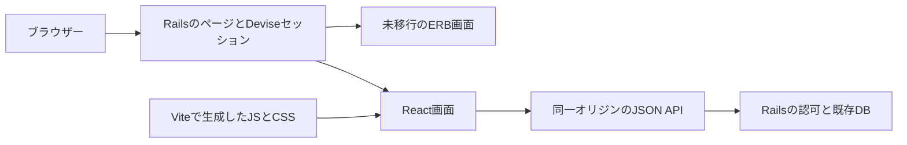

# Tsundokuのフロントエンド移行計画

既存の利用者操作をE2Eテストで確認できる状態にしてから、Railsの認証とデータを使いながら、画面をReactとTypeScriptへ段階的に移す。ビルドにはViteを採用する。React基盤の導入前にBunを比較検証し、依存管理とJavaScript実行環境の採用判断を行う。最初の画面はユーザー一覧と投稿詳細とし、更新系の操作と認証画面を後から移行する。

## 現状と今回の変更

現状はRuby 2.5.1、Rails 5.2、ERB、Sprockets、Bootstrap 4、jQuery、Rails UJS、Turbolinksで構成される。いいね・コメント・フォローは、サーバーが返す`.js.erb`をブラウザーで実行して更新している。`package.json`にはフロントの実装依存がなく、JSON APIの設計も必要になる。

今回のPRではPlaywrightとTypeScript、専用Compose環境、GitHub Actionsを導入する。React画面の実装は次のPRから始める。PCとモバイルのChromiumで、次の10シナリオを実行する。

| 分野 | E2Eで確認する操作 |
| --- | --- |
| 認証 | ゲスト表示と誤ったパスワード、新規登録からログアウト・再ログイン、アバター付き登録 |
| プロフィール | 現在のパスワードを使った名前・アバターの更新 |
| 投稿 | 画像なし投稿の詳細、画像投稿とサムネイル、共有投稿と保存後の画面遷移 |
| ソーシャル | いいねと取消、コメント作成と本人による削除、フォローと解除・双方の一覧 |

ブラウザーのCookieはテストごとに分離し、ユーザー名・メールアドレスは毎回生成する。DBとアップロード先は専用コンテナ内に置く。通常の開発DBや既存のアップロード画像を書き換える構成にしない。E2Eサーバーはdevelopment環境で起動するため、CSRF保護と実際のJavaScriptによる操作も確認できる。

テストは実際の登録・入力・クリックを使う。表示名とラベルを優先し、繰り返し表示される投稿だけ共通の`data-testid`で識別する。RailsのCSSクラスやDOM階層にテストを結び付けず、React側にも同じ操作上の識別子を引き継ぐ。[Playwrightの推奨方針](https://playwright.dev/docs/best-practices)

パスワード再設定、アカウント削除、入力不正、権限違反、通信失敗は、以下のAPI整備と同時に追加する。現在の正常系20ケースを「全機能の保証」とは扱わない。

## 移行後の構成

| 用途 | 採用する構成 | 役割 |
| --- | --- | --- |
| 画面 | React 19系 | ページと共通UIをコンポーネント化する |
| 言語 | TypeScriptのstrict設定 | APIとフォームの型を明確にする |
| 開発とビルド | Vite 8系 | 開発時の更新と本番用の静的ファイル生成を担当する |
| 依存管理とJS実行 | Node.js 24 LTSとnpmを基準にBunを比較検証 | 機能互換・再現性・実行時間を比較して採用範囲を決める |
| スタイル | CSS ModulesとCSS変数 | 新画面のスタイルを既存Bootstrapから分離する |
| サーバーデータ | TanStack Query | JSON APIの取得・再取得・更新後の整合を扱う |
| テスト | Playwright、Vitest、React Testing Library、既存RSpec | 利用者操作、部品、APIの責務を分けて確認する |
| バックエンド | Rails、Devise、既存DB | 認証・認可と業務処理を担当する |

2026年10月31日の調査時点の基準。実装開始時にパッチ版と対応Node.jsを確認し、lockfileで固定する。今回のE2EはPlaywright 1.64.1、TypeScript 7.0.2で固定している。[Reactのバージョン](https://react.dev/versions)、[Viteの実行要件](https://vite.dev/guide/)、[Node.jsのリリース状況](https://nodejs.org/en/about/previous-releases)

Railsが既存URLのHTMLを返し、その画面のReactルートをマウントする。URLとDeviseのセッションCookieを引き継ぎ、既存リンクやブラウザーの戻る操作を守る。初期のルーティングはRailsが担当する。画面内遷移の必要性が明確になった時点でReact Routerの導入を判断する。

最初のVite連携は、ビルド工程で生成したmanifestをRailsから読む方式を基本とする。ビルドの実行環境は以下のBun検証で決める。開発時はViteのHMRとReact Refresh、本番時はmanifestからJS・CSS・依存ファイルを読み込む。現在のRuby 2.5に最新のRails連携gemが入ることを前提にしない。Rails更新後に連携gemへ寄せるか再評価する。[Reactの段階導入](https://react.dev/learn/add-react-to-an-existing-project)、[Viteのバックエンド連携](https://vite.dev/guide/backend-integration)

## 実施順序と完了条件

1人が専任し、既存機能を維持する場合の概算。下表のフロントとAPI整備は、Bunの比較検証1〜2日を含めて合計13〜22開発日を目安とする。Ruby・Rails・DBの更新工数は互換性調査後に別途見積もる。

| 順序 | PRの範囲 | 目安 | 次へ進む条件 |
| --- | --- | --- | --- |
| 0 今回 | E2E・CI・回帰テストの実行手順 | 今回導入 | PCとモバイルの20ケース、RSpec、型チェックが成功する |
| 1 | 認可と入力検証、JSON APIの契約 | 2〜4日 | 他人の更新・削除が拒否され、401・403または404・422をrequest specで確認できる |
| 1.5 | Bunの検証と採用判断 | 1〜2日 | 依存管理・Vite・型チェック・E2E・CIを比較し、採用範囲と判断理由を記録する |
| 2 | React・Vite・CSS Modulesの基盤とユーザー一覧1画面 | 2日 | 開発時HMR、本番ビルド、直接アクセス、再読込、旧画面への切替が成功する |
| 3 | 投稿詳細、プロフィール、ユーザー一覧の読み取り画面 | 2〜3日 | 画像なし・空一覧・画像読込失敗を含めて表示でき、既存E2Eが成功する |
| 4 | いいね、コメント、フォローの更新操作 | 3〜5日 | 更新直後・再読込後の整合、二重送信、通信失敗時の復帰を確認できる |
| 5 | 投稿・共有・プロフィール・認証フォーム | 2〜4日 | 画像送信、422の項目別表示、未認証時の復帰先、ログアウト、再設定メールを確認できる |
| 6 | 旧JavaScriptと重複スタイルの撤去 | 1〜2日 | `.js.erb`、Rails UJS、Turbolinks、jQuery、Bootstrapの参照が対象画面からなくなり、全チェックと切り戻し確認が成功する |

### Bunの検証と採用判断

現在の検証基準はNode.js 24とnpmであり、このPRではBunでの動作確認は行っていない。Bunの検証は独立したPRで実施する。Viteとの組合せは[Bun公式の案内](https://bun.sh/guides/ecosystem/vite)を参照し、次の二段階を分けて評価する。

1. 依存管理にBunを使用し、Vite・型チェック・PlaywrightはNode.jsで実行する。
2. Vite・型チェック・Playwright自体もBunで実行する。実行コマンドとランタイムのバージョンをログに残し、CLIの指定によりNode.jsが使われる場合と区別する。E2Eの実行器はPlaywrightを継続する。

既存のE2Eと型チェックに加え、最小のReact・ViteサンプルでHMR、React Refresh、本番ビルド、Railsからのmanifest読込とJS・CSSの配信を検証する。本番ビルド結果を実際に表示するところまで確認してから、画面移行用の基盤へ反映する。

| 検証対象 | 確認内容 |
| --- | --- |
| 依存関係 | 同じパッケージ版を解決でき、固定したBunとlockfileでクリーンインストールを再現できる。必要なインストールスクリプトとネイティブ依存も確認する |
| 機能互換 | 同じ型チェック・PCとモバイルのE2E20ケース・最小React/Viteサンプルが成功し、再試行による成功に依存しない |
| CIと開発環境 | 固定ブラウザーコンテナに固定版Bunを追加し、GitHub ActionsのLinuxと開発用macOSで実行する。失敗時のレポート保存と終了コードも確認する |
| 実行時間 | 同じマシン・コード・依存バージョンで、キャッシュなし／ありを分けて各5回測定する。依存導入、開発サーバー起動、本番ビルド、E2EとCI全体の中央値・ばらつきを比較する |
| 運用 | lockfile更新、依存アップデート、バージョン固定、障害時の調査とNode.jsへの復帰に必要な手順を確認する |

機能互換と再現性を必須条件とし、時間短縮や運用上の利点を実測で示せる範囲を採用する。結論は「依存管理と実行環境の両方に採用」「依存管理だけ採用」「Node.jsとnpmを継続」のいずれかとし、測定結果と判断理由を計画書に追記する。互換性の問題や維持が難しい回避策が残る場合は、Node.jsとnpmを継続する。

採用した場合はCI成功後にlockfileを一本化する。Bunへの変更を独立したPRにまとめ、問題が出た場合はその変更を戻して検証済みのNode.jsとnpmの構成へ復帰できるようにする。

### JSON APIより先に整える処理

コントローラーには、パラメーターのユーザーIDをそのまま利用する箇所や、更新・削除対象を全件から検索する箇所がある。Reactから呼ぶAPIを増やす前に、利用者の権限をサーバーで検証する。

- プロフィール更新はログイン本人のレコードに限定する。
- コメントの作成者は`current_user`から決める。コメントといいねの削除は本人の関連から検索する。
- 未認証アクセス、存在しない投稿、必須項目の不足を例外任せにしない。ユーザーに表示するエラー形式を決める。
- 同じ投稿への複数コメントを許可するかを決める。現在はユーザーと投稿の組に一意制約相当のモデル検証がある。
- 共有投稿で画像も引き継ぐかを決める。現状のフォームにある画像URL入力を、そのまま新APIの仕様にはしない。

APIは`/api/v1`に設け、ページURLと既存のHTML・JavaScript応答を段階的に併存させる。JSONのフィールド、ページング、画像URL、422のエラー形式をOpenAPI等で定義し、TypeScript型を生成して手書きの重複を減らす。初期対象はユーザー一覧・詳細、投稿一覧・詳細、本人情報、いいね、コメント、フォロー。

### 認証と画面を共存させる条件

APIはRailsと同じオリジンで提供する。ReactはセッションCookieを送り、更新リクエストにRailsのCSRFトークンを付ける。APIの未認証応答はJSONの401とし、ログイン画面への移動と復帰先は画面側で扱う。

Reactのルート要素の内側はReactが更新する。既存jQueryの置換先や`data-remote`をReact要素へ重複して持ち込まない。移行画面ではTurbolinksの画面キャッシュとReactのマウント・破棄を明示的に管理する。新CSSのグローバルリセットを既存ERB画面へ適用しない。

## Railsとデータの更新

E2E・ViteのJavaScript実行環境は、現在のRails実行環境と別コンテナで動かす。現在の基準はNode.js 24とし、Bunは上記の検証結果に従って採用範囲を決める。これにより、Rails更新中もフロントの準備を進められる。新しいバックエンドを公開する段階では、Ruby・Rails・MySQLをサポート対象の組合せへ更新する。

RubyとRailsの更新は、対応するRuby版を挟みながらRailsのマイナー版ごとにPRを分ける。各段階でRSpecと同じE2Eを実行する。Devise、CarrierWave、画像処理、Cookie形式、DBアダプターを重点確認する。中間版は移行作業用とし、リリース先の最終構成とは区別する。[Rails公式の更新手順](https://guides.rubyonrails.org/upgrading_ruby_on_rails.html)

`vendor/bundle`と`mysql/mysql_data`には現在Git追跡中の実行時ファイルがある。実データの有無とバックアップを確認してから、依存管理とDBボリュームへ移す。DB更新は実データのコピーで復元を検証する。フロント移行のPRでは、既存カラムやアップロード画像を削除しない。

## リリース判定と切り戻し

- 画面単位のサーバー設定で、ERBとReactを切り替えられるようにする。初期値はERBとし、移行した画面から有効にする。
- 各画面を旧・新の両設定でE2Eに通す。APIの認可はRSpecで確認し、ブラウザーではセッション切れや送信失敗からの復帰も確認する。
- Reactの部品・フォームはVitestとReact Testing Libraryで確認する。E2Eは利用者が完了できる操作を確認し、すべての入力組合せをE2Eへ集めない。
- PRではPC・モバイルChromiumを必須にし、移行開始時にFirefoxとWebKitの定期実行を追加する。失敗をリトライで隠さず、再試行でのみ成功した場合もCIを失敗にする。
- CIの全体15分以内、E2E本体5分以内を目標にし、実測で調整する。失敗時のトレース・画像・動画とRailsログを7日間保持する。
- 切り戻しは対象画面の設定をERBへ戻す。旧画面が必要とするAPI・JSと、直前リリースのVite成果物を残す。データ変更は追加から始め、旧画面に戻せる期間を確保する。
- 500、認証・更新操作の失敗、二重送信、画像欠落が増えた場合は対象画面を戻し、同じE2Eへ再現ケースを追加する。許容値はリリース前に既存画面の実測と比較して定める。

次に着手するPRは「認可・入力検証と読み取りAPIの契約」。その後、Bunの比較検証で採用範囲を決め、ユーザー一覧をReactで表示する小さなPRで、Viteの配信と旧画面への切替を実証する。
